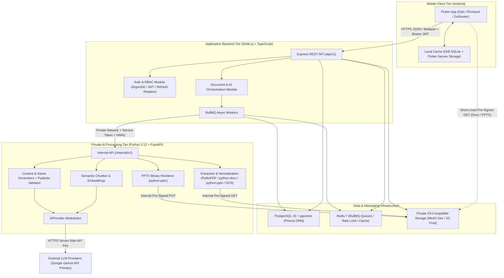
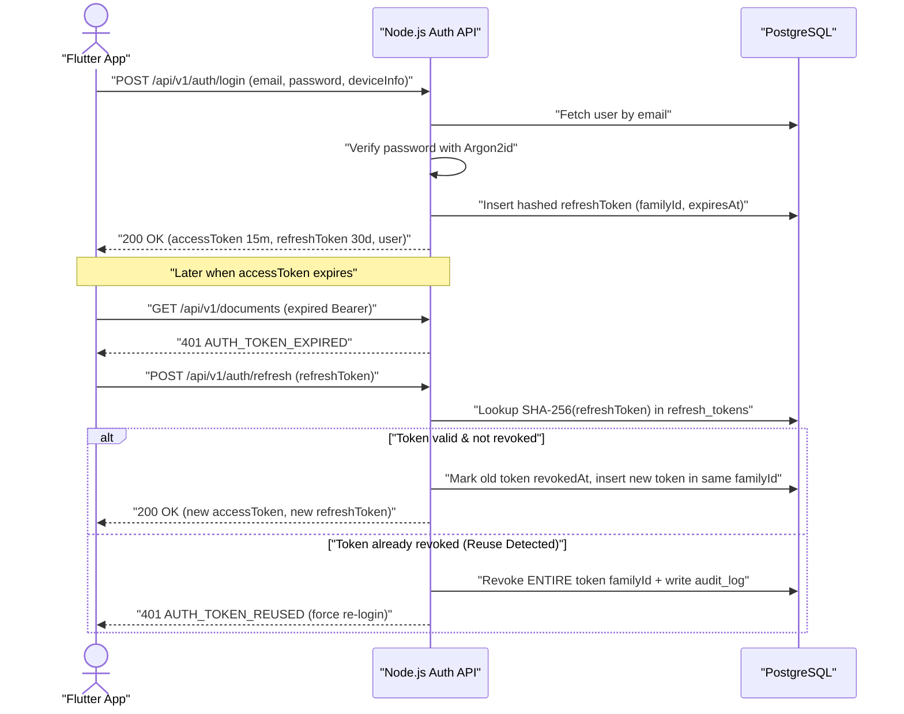
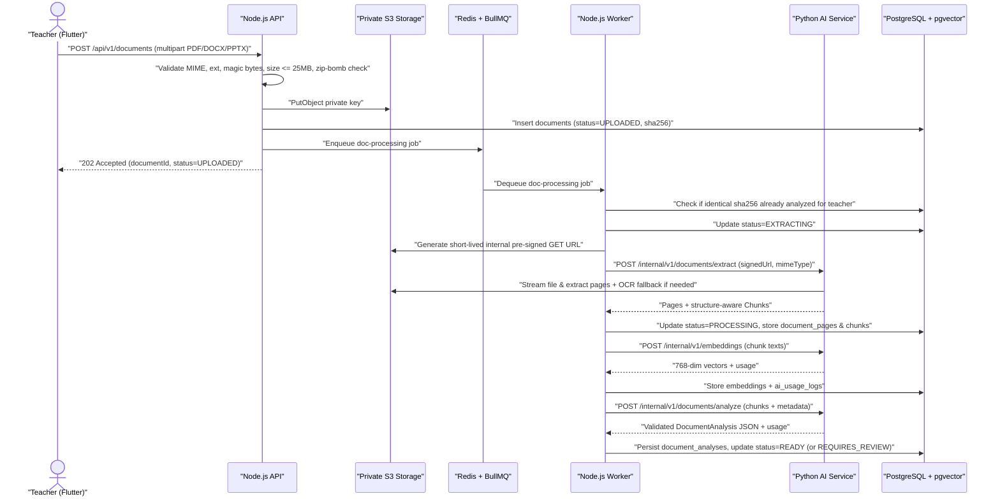
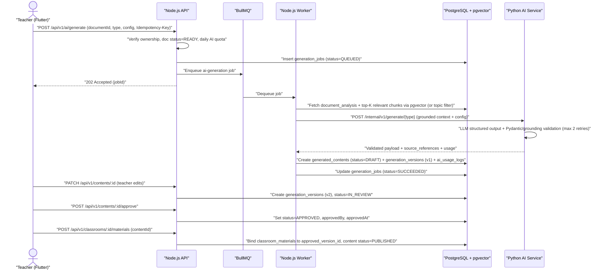

# System Architecture — AI-Powered Educational Learning Ecosystem

**Version:** 1.0  
**Phase:** Phase 0 — Project Discovery & Planning  
**Status:** Baseline Architecture Specification  
**Primary Sources:** `prd.md.txt` (v1.0), `rnd.md.txt` (v1.0), Master Execution Specification

---

## 1. Executive Overview & Product Principles

The AI-Powered Educational Learning Ecosystem is a multi-tier mobile platform built on **Flutter (Android)**, a **Node.js + TypeScript** application backend, a **Python + FastAPI** AI & document processing service, **PostgreSQL 16 + pgvector**, **Redis + BullMQ**, and **S3-compatible private object storage**.

The platform connects two active mobile user roles — **Teacher** and **Student** — while reserving backend role support for a future **Administrator** web dashboard:

1. **Teacher Workspace:** Upload learning materials (PDF, DOCX, PPTX), analyze document structure and concepts, generate grounded educational outputs (summaries, quizzes, presentations, flashcards, mind maps, worksheets, and educational games), review/edit/version those outputs, and publish approved materials into digital classrooms.
2. **Student Workspace:** Enroll in classrooms via unique classroom codes, access published materials (with offline caching support for unstable networks), complete quizzes and scheduled exams, play template-based educational games, and monitor learning progress.

### Governing Architectural Principles

- **AI as Assistant, Never Authority:** Every AI-generated output is stored as an unapproved `DRAFT` and MUST be reviewed and explicitly approved by a teacher before publication to students.
- **Source Grounding First:** Generated learning materials and games must trace back to extracted document pages and chunks (`source_reference`), flagging gaps instead of fabricating facts.
- **Single Database Writer:** The Node.js backend (via Prisma ORM and PostgreSQL) is the sole owner of schema migrations and persistent database state. The Python AI service is stateless and communicates only with the Node.js backend, object storage, and configured LLM providers.
- **Strict Security Boundaries:** The Python AI service and internal storage/queue infrastructure are never exposed to the Flutter client. All authentication, RBAC, IDOR checks, quotas, and AI orchestration run in Node.js.
- **No Uncontrolled Dependencies or Fabricated Prototypes:** Every boundary is defined by strict contracts (OpenAPI/REST JSON schemas + Pydantic models).

---

## 2. High-Level System Architecture



### Network & Trust Zones

| Zone | Components | Ingress Rules | Egress Rules |
|---|---|---|---|
| **Untrusted Client Zone** | Flutter Android App | User device | HTTPS to Node.js `/api/v1` and time-limited S3 pre-signed URLs |
| **DMZ / Application API** | Node.js Express (`/api/v1`) | Public HTTPS with TLS, CORS, rate limiting, JWT verification | PostgreSQL, Redis, S3, and Private AI Service |
| **Private Worker & AI Zone** | BullMQ Workers, Python FastAPI (`/internal/v1`) | Private Docker/VPC network only; requires `X-Internal-Service-Token` + HMAC-SHA256 signature | S3 internal endpoint, External LLM APIs |
| **Data Persistence Zone** | PostgreSQL + pgvector, Redis, MinIO/S3 | Private network only; zero public exposure | None |

---

## 3. Target Monorepo Structure

The repository will be organized as a cohesive monorepo starting in Phase 1:

```text
mobile/                               # Repository root (d:\proyek\mobile)
|-- prd.md.txt                        # Product Requirements Document (Primary Truth)
|-- rnd.md.txt                        # R&D Technical Specification (Primary Truth)
|-- README.md                         # Workspace quickstart & phase status
|-- .gitignore                        # Strict exclusion of .env, keys, builds, logs
|-- .env.example                      # Root template for local Docker Compose orchestration
|-- docs/                             # Phase 0 Architecture & Contract Deliverables
|   |-- architecture.md
|   |-- erd.md
|   |-- api-contract.md
|   |-- implementation-roadmap.md
|   `-- technical-decisions.md
|-- infra/                            # Local & deployment infrastructure
|   |-- docker-compose.yml            # PostgreSQL+pgvector, Redis, MinIO, backend, ai-service
|   |-- postgres/
|   |   `-- init.sql                  # Enables vector & pgcrypto extensions
|   `-- minio/
|       `-- bucket-policy.md          # Private bucket bootstrap rules
|-- backend/                          # Node.js + TypeScript + Express + Prisma
|   |-- package.json
|   |-- tsconfig.json
|   |-- .env.example
|   |-- prisma/
|   |   |-- schema.prisma
|   |   `-- migrations/
|   |-- src/
|   |   |-- app.ts                    # Express middleware, helmet, cors, routes, error handler
|   |   |-- server.ts                 # HTTP bootstrap & graceful shutdown
|   |   |-- worker.ts                 # BullMQ worker process entrypoint
|   |   |-- config/                   # Env validation (Zod), logger (Pino), storage, redis
|   |   |-- common/                   # Auth middleware, RBAC guards, rate limiters, errors, DTOs
|   |   `-- modules/
|   |       |-- auth/                 # Register, login, refresh rotation, logout, reset password
|   |       |-- users/                # User profiles, role metadata, password change
|   |       |-- documents/            # Upload validation, S3 keys, status lifecycle, analysis cache
|   |       |-- ai-orchestration/     # BullMQ producers/workers, Python client, quotas, usage logs
|   |       |-- contents/             # Drafts, editor updates, version history, approval, PPTX export
|   |       |-- classrooms/           # Classrooms, join codes, enrollment, material publishing
|   |       |-- assessments/          # Quizzes/exams, attempts, auto-grading, manual essay grading
|   |       |-- games/                # Game listing, play sessions, scoring, leaderboards
|   |       `-- analytics/            # Teacher classroom & assessment analytics, student progress
|   `-- tests/                        # Unit, integration, and RBAC/IDOR security tests (Vitest)
|-- ai-service/                       # Python 3.12 + FastAPI + Pydantic (managed via uv)
|   |-- pyproject.toml
|   |-- uv.lock
|   |-- .env.example
|   |-- app/
|   |   |-- main.py                   # FastAPI app, lifespan, internal auth dependency
|   |   |-- core/                     # Config, structured logging, internal HMAC security, errors
|   |   |-- api/                      # /internal/v1 routers (health, extract, embeddings, analyze, generate, export)
|   |   |-- schemas/                  # Pydantic v2 input/output contracts & validation
|   |   |-- extraction/               # PyMuPDF, python-docx, python-pptx, OCR fallback adapter
|   |   |-- normalization/            # Unicode cleanup, header/footer noise reduction, page mapping
|   |   |-- chunking/                 # Structure-aware hierarchical chunker with page citations
|   |   |-- providers/                # AIProvider ABC, GeminiProvider, MockProvider (dev/test only)
|   |   |-- prompts/                  # Versioned prompt templates & untrusted-content wrappers
|   |   |-- generators/               # Summary, Quiz, Presentation, Flashcard, MindMap, Worksheet, Game
|   |   |-- validation/               # Schema, deduplication, answer consistency, grounding checks
|   |   `-- exporters/                # python-pptx slide builder from validated Presentation JSON
|   `-- tests/                        # Pytest extraction, chunking, schema, prompt safety & AI evals
`-- mobile/                           # Flutter + Dart Android Application
    |-- pubspec.yaml
    |-- analysis_options.yaml
    |-- test/                         # Unit, repository, navigation, widget tests
    `-- lib/
        |-- main.dart
        |-- core/
        |   |-- config/               # Env flavors (API base URL via --dart-define)
        |   |-- constants/            # Spacing, typography, durations, API paths
        |   |-- errors/               # Typed failures, network error mapper
        |   |-- network/              # Dio client, auth interceptor, token refresh lock
        |   |-- router/               # GoRouter, role guards, TeacherShell, StudentShell
        |   |-- storage/              # FlutterSecureStorage wrapper, Drift SQLite DB
        |   |-- theme/                # Light/Dark ColorScheme, ThemeData, typography
        |   |-- utils/                # Validators, formatters, debouncers
        |   `-- widgets/              # Design system components + AppToast + ConfirmationDialog
        |-- shared/
        |   |-- models/               # Freezed/json_serializable domain models
        |   |-- providers/            # Auth state, connectivity, local cache providers
        |   `-- services/             # File picker, download/share, audio feedback
        `-- features/
            |-- authentication/       # Login, Register, Role Selection, Forgot/Reset Password
            |-- onboarding/           # First-run educational intro
            |-- profile/              # Profile view/edit, theme toggle, logout
            |-- teacher/
            |   |-- dashboard/
            |   |-- documents/        # Upload, list, status polling, detail, analysis view
            |   |-- ai_generator/     # Configure & trigger summary/quiz/slides/cards/map/sheet/game
            |   |-- content_editor/   # Structured editor, preview, versions, approve, publish
            |   |-- classrooms/       # Create/manage classes, codes, members, publish materials
            |   |-- assessments/      # Build exams, review attempts, grade essays
            |   `-- analytics/        # Class & per-question mastery insights
            `-- student/
                |-- dashboard/        # Home overview, upcoming tasks, progress summary
                |-- classrooms/       # Join class by code, class detail, material list
                |-- learning_materials/ # Summary, PPTX viewer/download, Flashcards, MindMap, Worksheet
                |-- assessments/      # Quiz/Exam runner, timer, submission, feedback review
                |-- educational_games/# Template game engine + 6 native Flutter renderers
                `-- progress/         # Score history, completion tracking, activity feed
```

---

## 4. Service Responsibilities & Module Boundaries

### 4.1. Flutter Mobile Client (`mobile/`)

- **State Management:** Riverpod (`flutter_riverpod` + `riverpod_annotation`) for deterministic async state (`AsyncValue`), strict separation of presentation widgets from repositories, and easy provider overrides in tests.
- **Navigation:** `GoRouter` with a `refreshListenable` bound to authentication state:
  - Unauthenticated users are directed to `/login` or `/register` (or `/onboarding` on first launch).
  - Authenticated `TEACHER` users enter `TeacherShell` with 6 destinations aligned to Section 5.3:
    1. `Dashboard` (`/teacher/dashboard`)
    2. `My Materials` (`/teacher/materials`)
    3. `AI Generator` (`/teacher/generator`)
    4. `My Classrooms` (`/teacher/classrooms`)
    5. `Assessments` (`/teacher/assessments`)
    6. `Profile` (`/teacher/profile`)
  - Authenticated `STUDENT` users enter `StudentShell` with 6 destinations aligned to Section 5.3:
    1. `Home` (`/student/home`)
    2. `My Classes` (`/student/classes`)
    3. `Learning` (`/student/learning`)
    4. `Assignments` (`/student/assignments`)
    5. `Progress` (`/student/progress`)
    6. `Profile` (`/student/profile`)
  - Cross-role URL access attempts redirect cleanly to the user's home shell; backend RBAC remains the authoritative security boundary.
- **HTTP & Token Refresh:** `Dio` configured with base URL from `--dart-define=API_BASE_URL`, timeouts, `X-Request-Id` header injection, and a `QueuedInterceptor` that atomically refreshes expired access tokens once when multiple concurrent requests return `401 AUTH_TOKEN_EXPIRED`. If refresh fails, secure tokens are cleared and the user is returned to `/login`.
- **Offline Caching:** `Drift` (type-safe SQLite) caches published classroom summaries, flashcards, mind maps, game configs, and read-progress markers so students with intermittent connectivity can keep studying and sync completion states when online. Sensitive tokens NEVER touch SQLite — they live exclusively in `FlutterSecureStorage` (Android EncryptedSharedPreferences / Keystore).

### 4.2. UI/UX Design System & Interaction Standards

- **Visual Direction:** Clean, modern, focused educational typography and high-contrast light/dark themes (`ColorScheme` meeting WCAG AA 4.5:1 contrast), generous whitespace, crisp 1dp hairline borders, and subtle elevation instead of heavy shadows or loud gradients.
- **Restrained Frosted Glass Navigation Chrome:** Floating `BottomNavigation` and sticky top navigation bar use light frosted glass (`BackdropFilter` with subtle `sigmaX/Y <= 10`, translucent surface `alpha ~0.82` in light mode / `~0.78` in dark mode, and a `1px` translucent border), with an automatic high-performance solid fallback when `MediaQuery.disableAnimations` is active or on low-memory devices so mid-range Android devices maintain 60fps. All content cards remain solid, crisp surfaces to avoid excessive glassmorphism.
- **Iconography Policy (Strict):**
  - **Zero emojis or emoticons** anywhere in UI, empty states, badges, or copy.
  - **Zero sparkles icons** anywhere in AI buttons, headers, or indicators.
  - Use modern vector icons consistently (`lucide_icons_flutter` or `material_symbols_rounded`), e.g., `cpu`, `sliders_horizontal`, `wand_2`, `book_open`, `layers`, `check_circle_2`, `alert_triangle`.
- **Feedback & Dialog Policy (Strict):**
  - Never use browser/native `alert()` or generic unstyled Snackbars for important feedback.
  - Use a themed `AppToast` overlay widget (success, error, warning, info variants with appropriate vector icons) and `ConfirmationDialog` for destructive/publishing actions.
- **Mandatory Component Library (`lib/core/widgets/`):**
  - `PrimaryButton`, `SecondaryButton`, `InputField`, `SearchField`, `ContentCard`, `DocumentCard`, `SubjectBadge`, `AppProgressIndicator`, `EmptyState`, `ErrorState`, `LoadingState`, `BottomNavigation`, `ConfirmationDialog`, `AppToast`.
- **Screen State Completeness:** Every screen explicitly implements `LoadingState` (skeleton/shimmer or spinner), `ErrorState` (message + retry callback), `EmptyState` (actionable CTA), and `AppToast` success/error notifications.

### 4.3. Node.js Application Backend (`backend/`)

- **Express + TypeScript:** Enforces strict Zod schema validation on `params`, `query`, and `body` before business logic runs.
- **Single Database Writer:** All Prisma queries and PostgreSQL migrations execute solely within `backend/`. Raw SQL is encapsulated cleanly in repository helpers only for `pgvector` cosine distance queries (`<=>`).
- **BullMQ Async Orchestration:** Document processing (`doc-processing` queue) and AI generation (`ai-generation` queue) execute asynchronously in dedicated Node.js workers so mobile HTTP requests never block on multi-page parsing or LLM latency.
- **Modular Ownership:**
  - `auth` & `users`: Registration, login, Argon2id verification, JWT signing, rotating refresh token family store, profile CRUD.
  - `documents`: Multipart upload intake (via `multer` temp stream -> validation -> S3 upload), SHA-256 deduplication check, status updates, pre-signed read URL generation.
  - `ai-orchestration`: Dispatches jobs to Python AI service, persists extracted pages/chunks/embeddings/analyses/generated versions, records token usage and USD cost estimates in `ai_usage_logs`, enforces per-teacher daily/monthly quotas.
  - `contents`: Draft retrieval, structured edits (creating new immutable `generation_versions`), restore previous version, teacher approval gate (`APPROVED`), PPTX binary export trigger.
  - `classrooms`: Classroom CRUD, cryptographically random unique class codes, student join/leave, publishing `APPROVED` content versions as `classroom_materials`.
  - `assessments`: Assessment scheduling/configuration, question snapshots, attempt start/save/submit, automatic grading of `MULTIPLE_CHOICE` and `TRUE_FALSE` (plus exact-match normalization helper for `SHORT_ANSWER` if configured), manual teacher grading for `ESSAY`/`SHORT_ANSWER`, score recalculation.
  - `games` & `analytics`: Game config delivery (sourced from approved `GAME` content), play session scoring, leaderboard aggregation, teacher item-difficulty & topic-weakness analytics.

### 4.4. Python AI Processing Service (`ai-service/`)

- **Private Stateless Service (Python 3.12 + FastAPI):** Has zero direct connection to the mobile client and zero direct write connection to PostgreSQL.
- **Extraction Engine:**
  - **PDF:** `PyMuPDF` (`fitz`) page-by-page text and layout block extraction; detects scanned/image-only pages (`text_length < threshold`) and delegates only those pages to OCR (`Tesseract` / `pytesseract` or `PaddleOCR` optional worker flag).
  - **DOCX:** `python-docx` paragraph, heading hierarchy, list, and table extraction mapped into logical sections/pages.
  - **PPTX:** `python-pptx` slide title, body bullet, table, and speaker note extraction indexed by slide number (`page_number = slide_index`).
- **Normalization & Structure-Aware Chunking:** Cleans broken hyphenation, normalizes Unicode (`NFKC`), strips repeating headers/footers across pages, preserves chapter/heading metadata, and chunks into 500–900 token segments with ~100 token overlap while recording exact `page_start`, `page_end`, and `heading_path`.
- **Provider Abstraction (`AIProvider`):**
  - Abstract base class exposing `generate_text()`, `generate_structured(schema)`, `generate_embedding()`, and `analyze_document()`.
  - Default implementation: `GeminiProvider` using the official `google-genai` SDK with tiered model routing (fast model for classification/extraction helpers, high-capability model for pedagogical analysis & content synthesis, `text-embedding-004` / `gemini-embedding-001` constrained to `768` dimensions for pgvector).
  - Test implementation: `DeterministicMockProvider` enabled ONLY when `APP_ENV=test` for unit/contract CI tests; never enabled in staging or production.
- **Validation & PPTX Synthesis:**
  - Every LLM response is validated via Pydantic v2 + business rules (no duplicate questions, valid option matching `correct_answer` for MCQ, non-empty explanations, valid `source_reference` pointing to existing document pages/chunks). Failed validations trigger up to 2 structured repair retries before failing the job transparently.
  - `python-pptx` consumes validated `Presentation` JSON and renders styled `.pptx` decks into private S3 storage.

---

## 5. Core End-to-End Workflows

### 5.1. Authentication & Refresh Token Rotation



### 5.2. Document Upload & Async Intelligence Pipeline



### 5.3. AI Content Generation, Review & Classroom Publishing



### 5.4. Classroom Assessment & Hybrid Grading

1. Teacher selects an `APPROVED`/`PUBLISHED` quiz content (or manually creates/customizes questions) and creates an `assessment` in a classroom (`SELF_QUIZ`, `ASSIGNMENT`, or `SCHEDULED_EXAM`) with `time_limit_seconds`, `max_attempts`, `available_from`, `available_until`, and `publish_results_mode`.
2. Backend snapshots questions into `assessment_questions` (marking `correct_answer` hidden from students while attempt is active).
3. Enrolled student calls `POST /api/v1/assessments/:id/attempts`. Backend checks enrollment, time window, and `attempt_count < max_attempts`, returning sanitized questions (without answer keys).
4. Student saves answers progressively (`PUT /api/v1/attempts/:attemptId/answers`) and submits (`POST /api/v1/attempts/:attemptId/submit`).
5. Backend enforces deadline tolerance, auto-grades `MULTIPLE_CHOICE` and `TRUE_FALSE` immediately, marks attempt `SUBMITTED` if essays/short answers require manual grading (or `GRADED` if fully objective), and records `learning_activities` + `student_progress`.
6. Teacher reviews pending essay responses (`POST /api/v1/attempts/:attemptId/grade`), finalizing total score and releasing explanations per assessment settings.

### 5.5. Template-Based Educational Game Engine

1. AI generates ONLY declarative JSON matching one of 6 validated schemas (`quiz_battle`, `word_matching`, `true_false`, `memory_cards`, `crossword`, `word_puzzle`), never executable code or Flutter scripts.
2. Teacher reviews and approves the game configuration and publishes it to a classroom.
3. Flutter renders the published configuration using 6 dedicated, native, accessible widgets (`QuizBattleRenderer`, `WordMatchingRenderer`, `TrueFalseRenderer`, `MemoryCardRenderer`, `CrosswordRenderer`, `WordPuzzleRenderer`) with timer, immediate feedback, score computation, and offline-resilient result queuing.
4. Client posts completed session metrics (`POST /api/v1/games/:materialId/sessions`); backend verifies enrollment, validates score bounds against the configuration's `max_possible_score` and minimum duration sanity checks, persists `game_sessions`, and updates classroom leaderboards.

---

## 6. Security Architecture & Threat Model

| Threat Vector | Mitigation Controls |
|---|---|
| **Unauthorized API & Cross-User Access (IDOR)** | Every protected endpoint extracts `userId` and `role` from verified JWT claims and enforces resource ownership (`document.teacherId === userId`, `classroom.teacherId === userId`) or active membership (`classroom_members` active record for `STUDENT`). |
| **Credential Compromise & Brute Force** | Passwords hashed with Argon2id (memory-hard parameters). Login and password-reset endpoints guarded by strict Redis-backed IP + account rate limiters. Refresh tokens stored only as SHA-256 hashes with reuse detection. |
| **Malicious File Uploads & Zip Bombs** | Server checks file extension, declared MIME, magic-byte file signature (`%PDF`, `PK\x03\x04` with OOXML structure verification), max size (`25 MB`), and uncompressed archive entry size/ratio limits (`<= 100 MB` expanded) before storing in private S3. |
| **Exposed AI Keys or Internal Service Access** | LLM API keys exist solely in Python AI service environment variables (`process`/container secret store). Python `/internal/v1` requires private network routing plus `X-Internal-Service-Token` and time-windowed HMAC-SHA256 signature verification. |
| **Prompt Injection via Uploaded Documents** | Extracted document text is strictly treated as untrusted data: passed exclusively inside user-turn `<untrusted_source_document>` XML fences, stripped of control characters, separated from immutable system instructions (`system_instruction`), and post-validated by Pydantic schemas + citation existence checks. |
| **AI Cost Exhaustion / Abuse** | Per-teacher daily/monthly generation limits and token budgets checked by Node.js before enqueuing BullMQ jobs; idempotency keys prevent accidental double-charges; SHA-256 document hash prevents re-analyzing unchanged documents. |
| **Student Data Leakage** | Student assessment answers, attempts, and analytics are strictly scoped to the owning student or the classroom's owning teacher. Answer keys and explanations are stripped from active student assessment payloads. |
| **Secrets in Source Control** | Root `.gitignore` blocks `.env`, `.env.*`, `*.key`, `*.pem`, dumps, and build logs. Only `.env.example` with empty/placeholder keys is committed. |

---

## 7. Reliability, Offline Support & Observability

- **Correlation & Structured Logging:** Every mobile request attaches or receives an `X-Request-Id` UUID propagated across Express, BullMQ job payloads, and FastAPI logs. Logs use JSON format (Pino in Node.js, `structlog`/JSON formatter in Python) and redact `authorization`, `password`, `token`, and PII fields.
- **Job Resilience:** BullMQ configures exponential backoff (3 retries for transient LLM/network 429/5xx errors), dead-letter visibility (`FAILED` state with sanitized error code/message), and job deduplication locks so tapping "Generate" twice with the same `Idempotency-Key` returns the existing job.
- **Mobile Offline Resilience:** Drift SQLite caches classroom lists, approved summaries, flashcards, mind maps, and recent quiz results locally. Pending progress updates queue safely and sync automatically upon reconnection, surfaced clearly via subtle offline status banners rather than blocking crashes.
