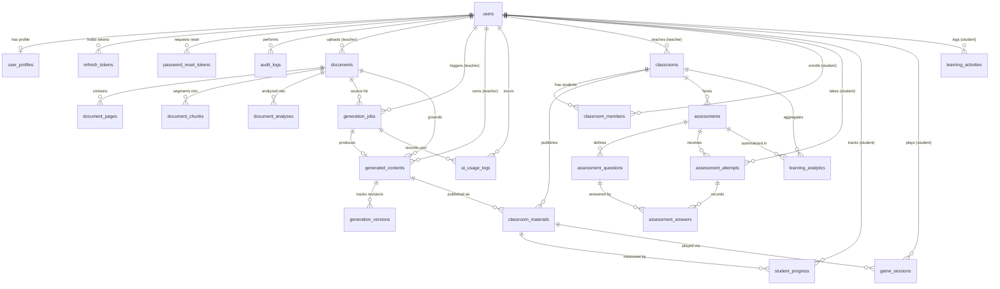

# Entity Relationship Diagram & Database Design

**Version:** 1.0  
**Phase:** Phase 0 — Project Discovery & Planning  
**Database Engine:** PostgreSQL 16 + `pgvector` (`vector` extension) + `pgcrypto`  
**ORM & Migrations:** Prisma ORM (Node.js Backend is the Single Database Writer; migrations only, zero `db push` in production)

---

## 1. Database Design Standards

1. **Primary Keys:** UUIDv4/v7 (`UUID`) generated at application/DB level (`gen_random_uuid()`), avoiding predictable sequential integers to protect against ID enumeration.
2. **Timestamps:** All timestamps stored in UTC (`TIMESTAMPTZ`). All mutable tables include `created_at` and `updated_at`.
3. **Soft Deletes:** Primary business entities (`users`, `documents`, `generated_contents`, `classrooms`, `assessments`) include `deleted_at TIMESTAMPTZ NULL`. Uniqueness constraints on soft-deletable records use partial unique indexes (`WHERE deleted_at IS NULL`) so archived/deleted items do not block legitimate re-creation.
4. **Vector Storage:** `document_chunks.embedding` uses `vector(768)` indexed with `HNSW` (`vector_cosine_ops`) for fast semantic retrieval scoped by `document_id`.
5. **Hybrid Relational + JSONB Strategy:** Core entities, ownership, statuses, foreign keys, and queryable analytics use normalized relational columns; flexible validated AI outputs (summaries, mind map trees, worksheets, game configs) and version snapshots use validated `JSONB`.

---

## 2. Entity Relationship Diagram (24 Core Entities)

---

## 3. Domain-by-Domain Table Specifications

### Domain A: User & Authentication (5 Tables)

#### A.1. `users`
| Column | Type | Constraints | Notes |
|---|---|---|---|
| `id` | `UUID` | `PK, DEFAULT gen_random_uuid()` | |
| `email` | `VARCHAR(255)` | `NOT NULL` | Lowercased & trimmed; partial unique where `deleted_at IS NULL` |
| `password_hash` | `TEXT` | `NOT NULL` | Argon2id PHC string |
| `role` | `UserRole` | `NOT NULL` | Enum: `TEACHER`, `STUDENT`, `ADMIN` |
| `status` | `UserStatus` | `NOT NULL, DEFAULT 'ACTIVE'` | Enum: `ACTIVE`, `SUSPENDED`, `PENDING_VERIFICATION` |
| `last_login_at` | `TIMESTAMPTZ` | `NULL` | |
| `created_at` | `TIMESTAMPTZ` | `NOT NULL, DEFAULT NOW()` | |
| `updated_at` | `TIMESTAMPTZ` | `NOT NULL, DEFAULT NOW()` | |
| `deleted_at` | `TIMESTAMPTZ` | `NULL` | Soft delete |

**Indexes:** `UNIQUE INDEX uq_users_email_active ON users (LOWER(email)) WHERE deleted_at IS NULL`, `INDEX idx_users_role ON users (role)`.

#### A.2. `user_profiles`
| Column | Type | Constraints | Notes |
|---|---|---|---|
| `id` | `UUID` | `PK, DEFAULT gen_random_uuid()` | |
| `user_id` | `UUID` | `UNIQUE, NOT NULL, FK -> users(id) ON DELETE CASCADE` | 1:1 with user |
| `full_name` | `VARCHAR(150)` | `NOT NULL` | |
| `display_name` | `VARCHAR(80)` | `NULL` | |
| `avatar_storage_key` | `VARCHAR(512)` | `NULL` | Private S3 object key |
| `institution_name` | `VARCHAR(150)` | `NULL` | School/university name |
| `subject_specialty` | `VARCHAR(120)` | `NULL` | Primarily for teachers |
| `grade_level` | `VARCHAR(60)` | `NULL` | Primarily for students |
| `bio` | `TEXT` | `NULL` | Max 500 chars enforced in app |
| `preferred_locale` | `VARCHAR(10)` | `NOT NULL, DEFAULT 'id'` | `id` or `en` |
| `created_at` | `TIMESTAMPTZ` | `NOT NULL, DEFAULT NOW()` | |
| `updated_at` | `TIMESTAMPTZ` | `NOT NULL, DEFAULT NOW()` | |

#### A.3. `refresh_tokens`
| Column | Type | Constraints | Notes |
|---|---|---|---|
| `id` | `UUID` | `PK, DEFAULT gen_random_uuid()` | |
| `user_id` | `UUID` | `NOT NULL, FK -> users(id) ON DELETE CASCADE` | |
| `family_id` | `UUID` | `NOT NULL` | Tracks token rotation chain for reuse detection |
| `token_hash` | `CHAR(64)` | `UNIQUE, NOT NULL` | SHA-256 hex digest of opaque token |
| `device_name` | `VARCHAR(120)` | `NULL` | Android device label |
| `ip_address` | `VARCHAR(45)` | `NULL` | Masked/truncated if privacy policy requires |
| `user_agent` | `VARCHAR(255)` | `NULL` | |
| `expires_at` | `TIMESTAMPTZ` | `NOT NULL` | |
| `revoked_at` | `TIMESTAMPTZ` | `NULL` | Set upon rotation or logout |
| `replaced_by_token_id` | `UUID` | `NULL, FK -> refresh_tokens(id) ON DELETE SET NULL` | |
| `created_at` | `TIMESTAMPTZ` | `NOT NULL, DEFAULT NOW()` | |

**Indexes:** `INDEX idx_refresh_tokens_user_active ON refresh_tokens (user_id, expires_at) WHERE revoked_at IS NULL`, `INDEX idx_refresh_tokens_family ON refresh_tokens (family_id)`.

#### A.4. `password_reset_tokens`
| Column | Type | Constraints | Notes |
|---|---|---|---|
| `id` | `UUID` | `PK, DEFAULT gen_random_uuid()` | |
| `user_id` | `UUID` | `NOT NULL, FK -> users(id) ON DELETE CASCADE` | |
| `token_hash` | `CHAR(64)` | `UNIQUE, NOT NULL` | SHA-256 of OTP/reset token |
| `expires_at` | `TIMESTAMPTZ` | `NOT NULL` | 15 minutes lifetime |
| `used_at` | `TIMESTAMPTZ` | `NULL` | Single use |
| `created_at` | `TIMESTAMPTZ` | `NOT NULL, DEFAULT NOW()` | |

**Indexes:** `INDEX idx_pwd_reset_user ON password_reset_tokens (user_id, expires_at) WHERE used_at IS NULL`.

#### A.5. `audit_logs`
| Column | Type | Constraints | Notes |
|---|---|---|---|
| `id` | `UUID` | `PK, DEFAULT gen_random_uuid()` | |
| `actor_user_id` | `UUID` | `NULL, FK -> users(id) ON DELETE SET NULL` | Null for system jobs |
| `action` | `VARCHAR(80)` | `NOT NULL` | e.g., `AUTH_LOGIN`, `AUTH_TOKEN_REUSED`, `CONTENT_PUBLISHED` |
| `entity_type` | `VARCHAR(60)` | `NOT NULL` | e.g., `DOCUMENT`, `CLASSROOM`, `ASSESSMENT` |
| `entity_id` | `UUID` | `NULL` | |
| `request_id` | `VARCHAR(64)` | `NULL` | Correlated `X-Request-Id` |
| `ip_address` | `VARCHAR(45)` | `NULL` | |
| `metadata` | `JSONB` | `NOT NULL, DEFAULT '{}'` | Non-sensitive event metadata only |
| `created_at` | `TIMESTAMPTZ` | `NOT NULL, DEFAULT NOW()` | |

**Indexes:** `INDEX idx_audit_actor_time ON audit_logs (actor_user_id, created_at DESC)`, `INDEX idx_audit_entity ON audit_logs (entity_type, entity_id)`.

---

### Domain B: Document Intelligence (4 Tables)

#### B.1. `documents`
| Column | Type | Constraints | Notes |
|---|---|---|---|
| `id` | `UUID` | `PK, DEFAULT gen_random_uuid()` | |
| `teacher_id` | `UUID` | `NOT NULL, FK -> users(id) ON DELETE RESTRICT` | Owner |
| `title` | `VARCHAR(200)` | `NOT NULL` | |
| `description` | `TEXT` | `NULL` | |
| `subject` | `VARCHAR(100)` | `NOT NULL` | e.g., `Biologi`, `Matematika` |
| `topic` | `VARCHAR(150)` | `NULL` | |
| `original_filename` | `VARCHAR(255)` | `NOT NULL` | Sanitized original name |
| `file_format` | `DocumentFormat` | `NOT NULL` | Enum: `PDF`, `DOCX`, `PPTX` |
| `mime_type` | `VARCHAR(120)` | `NOT NULL` | |
| `file_size_bytes` | `BIGINT` | `NOT NULL, CHECK (file_size_bytes > 0)` | Max 26,214,400 (25 MB) |
| `sha256_checksum` | `CHAR(64)` | `NOT NULL` | Integrity & dedup hash |
| `storage_bucket` | `VARCHAR(100)` | `NOT NULL` | |
| `storage_key` | `VARCHAR(512)` | `UNIQUE, NOT NULL` | Private S3 path |
| `page_count` | `INT` | `NULL` | Slide count for PPTX, logical pages for DOCX |
| `word_count` | `INT` | `NULL` | |
| `status` | `DocumentStatus` | `NOT NULL, DEFAULT 'UPLOADED'` | `UPLOADED`, `VALIDATING`, `EXTRACTING`, `PROCESSING`, `ANALYZED`, `READY`, `REQUIRES_REVIEW`, `FAILED` |
| `processing_progress` | `SMALLINT` | `NOT NULL, DEFAULT 0` | `0..100` |
| `failure_code` | `VARCHAR(60)` | `NULL` | |
| `failure_message` | `TEXT` | `NULL` | Safe user-facing summary |
| `processed_at` | `TIMESTAMPTZ` | `NULL` | |
| `created_at` | `TIMESTAMPTZ` | `NOT NULL, DEFAULT NOW()` | |
| `updated_at` | `TIMESTAMPTZ` | `NOT NULL, DEFAULT NOW()` | |
| `deleted_at` | `TIMESTAMPTZ` | `NULL` | Soft delete |

**Indexes:** `INDEX idx_documents_teacher_active ON documents (teacher_id, created_at DESC) WHERE deleted_at IS NULL`, `INDEX idx_documents_teacher_subject ON documents (teacher_id, subject) WHERE deleted_at IS NULL`, `INDEX idx_documents_sha256 ON documents (teacher_id, sha256_checksum) WHERE deleted_at IS NULL`.

#### B.2. `document_pages`
| Column | Type | Constraints | Notes |
|---|---|---|---|
| `id` | `UUID` | `PK, DEFAULT gen_random_uuid()` | |
| `document_id` | `UUID` | `NOT NULL, FK -> documents(id) ON DELETE CASCADE` | |
| `page_number` | `INT` | `NOT NULL, CHECK (page_number >= 1)` | 1-based page or slide index |
| `heading` | `VARCHAR(255)` | `NULL` | Detected top heading on page |
| `raw_text` | `TEXT` | `NOT NULL` | Extracted raw text |
| `normalized_text` | `TEXT` | `NOT NULL` | Cleaned text for chunking/citations |
| `extraction_method` | `VARCHAR(30)` | `NOT NULL` | `PYMUPDF`, `OCR`, `DOCX`, `PPTX` |
| `char_count` | `INT` | `NOT NULL` | |
| `created_at` | `TIMESTAMPTZ` | `NOT NULL, DEFAULT NOW()` | |

**Constraints & Indexes:** `UNIQUE (document_id, page_number)`.

#### B.3. `document_chunks`
| Column | Type | Constraints | Notes |
|---|---|---|---|
| `id` | `UUID` | `PK, DEFAULT gen_random_uuid()` | |
| `document_id` | `UUID` | `NOT NULL, FK -> documents(id) ON DELETE CASCADE` | |
| `chunk_index` | `INT` | `NOT NULL, CHECK (chunk_index >= 0)` | Sequential order |
| `chapter_title` | `VARCHAR(255)` | `NULL` | |
| `section_title` | `VARCHAR(255)` | `NULL` | |
| `page_start` | `INT` | `NOT NULL` | Source start page |
| `page_end` | `INT` | `NOT NULL` | Source end page |
| `token_count` | `INT` | `NOT NULL` | Approximate token budget |
| `content` | `TEXT` | `NOT NULL` | Chunk text body |
| `embedding` | `vector(768)` | `NULL` | 768-dim embedding vector |
| `metadata` | `JSONB` | `NOT NULL, DEFAULT '{}'` | Heading path, flags |
| `created_at` | `TIMESTAMPTZ` | `NOT NULL, DEFAULT NOW()` | |

**Constraints & Indexes:** `UNIQUE (document_id, chunk_index)`, `INDEX idx_chunks_embedding_hnsw ON document_chunks USING hnsw (embedding vector_cosine_ops) WITH (m = 16, ef_construction = 64)`.

#### B.4. `document_analyses`
| Column | Type | Constraints | Notes |
|---|---|---|---|
| `id` | `UUID` | `PK, DEFAULT gen_random_uuid()` | |
| `document_id` | `UUID` | `NOT NULL, FK -> documents(id) ON DELETE CASCADE` | |
| `document_sha256` | `CHAR(64)` | `NOT NULL` | Prevents re-analyzing unchanged file |
| `detected_subject` | `VARCHAR(120)` | `NOT NULL` | |
| `main_topic` | `VARCHAR(255)` | `NOT NULL` | |
| `language` | `VARCHAR(16)` | `NOT NULL, DEFAULT 'id'` | |
| `subtopics` | `JSONB` | `NOT NULL` | Array of subtopic objects + page refs |
| `key_concepts` | `JSONB` | `NOT NULL` | Array of `{name, description, source_pages}` |
| `definitions` | `JSONB` | `NOT NULL` | Array of `{term, definition, page}` |
| `learning_objectives` | `JSONB` | `NOT NULL` | Array of strings |
| `chapter_structure` | `JSONB` | `NOT NULL` | Hierarchical chapter/topic/concept tree |
| `model_name` | `VARCHAR(80)` | `NOT NULL` | Model used for analysis |
| `created_at` | `TIMESTAMPTZ` | `NOT NULL, DEFAULT NOW()` | |
| `updated_at` | `TIMESTAMPTZ` | `NOT NULL, DEFAULT NOW()` | |

**Constraints & Indexes:** `UNIQUE (document_id, document_sha256)`.

---

### Domain C: AI Generation, Versioning & Usage (4 Tables)

#### C.1. `generation_jobs`
| Column | Type | Constraints | Notes |
|---|---|---|---|
| `id` | `UUID` | `PK, DEFAULT gen_random_uuid()` | |
| `teacher_id` | `UUID` | `NOT NULL, FK -> users(id) ON DELETE RESTRICT` | |
| `document_id` | `UUID` | `NOT NULL, FK -> documents(id) ON DELETE CASCADE` | |
| `content_type` | `ContentType` | `NOT NULL` | `SUMMARY`, `QUIZ`, `PRESENTATION`, `FLASHCARDS`, `MIND_MAP`, `WORKSHEET`, `GAME` |
| `game_type` | `GameType` | `NULL` | Required if `content_type = 'GAME'` |
| `idempotency_key` | `VARCHAR(100)` | `NULL` | Prevents duplicate mobile retries |
| `bull_job_id` | `VARCHAR(100)` | `NULL` | BullMQ reference |
| `request_config` | `JSONB` | `NOT NULL` | Difficulty, count, topic focus, style |
| `status` | `JobStatus` | `NOT NULL, DEFAULT 'QUEUED'` | `QUEUED`, `RUNNING`, `VALIDATING`, `SUCCEEDED`, `FAILED`, `CANCELLED` |
| `progress` | `SMALLINT` | `NOT NULL, DEFAULT 0` | `0..100` |
| `attempt_count` | `SMALLINT` | `NOT NULL, DEFAULT 0` | |
| `error_code` | `VARCHAR(60)` | `NULL` | |
| `error_message` | `TEXT` | `NULL` | |
| `started_at` | `TIMESTAMPTZ` | `NULL` | |
| `completed_at` | `TIMESTAMPTZ` | `NULL` | |
| `created_at` | `TIMESTAMPTZ` | `NOT NULL, DEFAULT NOW()` | |
| `updated_at` | `TIMESTAMPTZ` | `NOT NULL, DEFAULT NOW()` | |

**Indexes:** `UNIQUE INDEX uq_gen_jobs_idempotency ON generation_jobs (teacher_id, idempotency_key) WHERE idempotency_key IS NOT NULL`, `INDEX idx_gen_jobs_teacher_status ON generation_jobs (teacher_id, status, created_at DESC)`.

#### C.2. `generated_contents`
| Column | Type | Constraints | Notes |
|---|---|---|---|
| `id` | `UUID` | `PK, DEFAULT gen_random_uuid()` | |
| `teacher_id` | `UUID` | `NOT NULL, FK -> users(id) ON DELETE RESTRICT` | |
| `document_id` | `UUID` | `NOT NULL, FK -> documents(id) ON DELETE RESTRICT` | |
| `generation_job_id` | `UUID` | `NULL, FK -> generation_jobs(id) ON DELETE SET NULL` | |
| `content_type` | `ContentType` | `NOT NULL` | |
| `game_type` | `GameType` | `NULL` | |
| `title` | `VARCHAR(255)` | `NOT NULL` | |
| `subject` | `VARCHAR(100)` | `NULL` | |
| `status` | `ContentStatus` | `NOT NULL, DEFAULT 'DRAFT'` | `DRAFT`, `IN_REVIEW`, `APPROVED`, `PUBLISHED`, `ARCHIVED` |
| `current_version_id` | `UUID` | `NULL` | Logical ref to latest `generation_versions.id` |
| `approved_version_id` | `UUID` | `NULL` | Logical ref to approved `generation_versions.id` |
| `approved_by` | `UUID` | `NULL, FK -> users(id) ON DELETE SET NULL` | |
| `approved_at` | `TIMESTAMPTZ` | `NULL` | |
| `export_storage_key` | `VARCHAR(512)` | `NULL` | Private S3 key for generated `.pptx` |
| `export_generated_at` | `TIMESTAMPTZ` | `NULL` | |
| `created_at` | `TIMESTAMPTZ` | `NOT NULL, DEFAULT NOW()` | |
| `updated_at` | `TIMESTAMPTZ` | `NOT NULL, DEFAULT NOW()` | |
| `deleted_at` | `TIMESTAMPTZ` | `NULL` | |

**Indexes:** `INDEX idx_contents_teacher_active ON generated_contents (teacher_id, content_type, status) WHERE deleted_at IS NULL`, `INDEX idx_contents_document ON generated_contents (document_id) WHERE deleted_at IS NULL`.

#### C.3. `generation_versions`
| Column | Type | Constraints | Notes |
|---|---|---|---|
| `id` | `UUID` | `PK, DEFAULT gen_random_uuid()` | |
| `content_id` | `UUID` | `NOT NULL, FK -> generated_contents(id) ON DELETE CASCADE` | |
| `version_number` | `INT` | `NOT NULL, CHECK (version_number >= 1)` | |
| `created_by` | `UUID` | `NOT NULL, FK -> users(id) ON DELETE RESTRICT` | |
| `origin` | `VersionOrigin` | `NOT NULL` | `AI_GENERATED`, `TEACHER_EDITED`, `AI_REGENERATED`, `RESTORED` |
| `change_note` | `VARCHAR(255)` | `NULL` | |
| `payload` | `JSONB` | `NOT NULL` | Full schema-validated structured payload |
| `source_references` | `JSONB` | `NOT NULL, DEFAULT '[]'` | Aggregated page/chunk citations |
| `validation_report` | `JSONB` | `NOT NULL, DEFAULT '{}'` | Schema & grounding check summary |
| `created_at` | `TIMESTAMPTZ` | `NOT NULL, DEFAULT NOW()` | Immutable once created |

**Constraints & Indexes:** `UNIQUE (content_id, version_number)`.

#### C.4. `ai_usage_logs`
| Column | Type | Constraints | Notes |
|---|---|---|---|
| `id` | `UUID` | `PK, DEFAULT gen_random_uuid()` | |
| `user_id` | `UUID` | `NOT NULL, FK -> users(id) ON DELETE RESTRICT` | |
| `document_id` | `UUID` | `NULL, FK -> documents(id) ON DELETE SET NULL` | |
| `generation_job_id` | `UUID` | `NULL, FK -> generation_jobs(id) ON DELETE SET NULL` | |
| `operation` | `VARCHAR(60)` | `NOT NULL` | `EMBEDDING`, `ANALYZE`, `GENERATE_QUIZ`, etc. |
| `provider` | `VARCHAR(40)` | `NOT NULL` | `gemini`, `openai`, etc. |
| `model` | `VARCHAR(80)` | `NOT NULL` | |
| `prompt_tokens` | `INT` | `NOT NULL, DEFAULT 0` | |
| `completion_tokens` | `INT` | `NOT NULL, DEFAULT 0` | |
| `total_tokens` | `INT` | `NOT NULL, DEFAULT 0` | |
| `estimated_cost_usd` | `NUMERIC(10,6)` | `NOT NULL, DEFAULT 0` | |
| `latency_ms` | `INT` | `NOT NULL, DEFAULT 0` | |
| `success` | `BOOLEAN` | `NOT NULL` | |
| `error_code` | `VARCHAR(60)` | `NULL` | |
| `created_at` | `TIMESTAMPTZ` | `NOT NULL, DEFAULT NOW()` | |

**Indexes:** `INDEX idx_ai_usage_user_date ON ai_usage_logs (user_id, created_at DESC)`.

---

### Domain D: Classroom & Material Distribution (3 Tables)

#### D.1. `classrooms`
| Column | Type | Constraints | Notes |
|---|---|---|---|
| `id` | `UUID` | `PK, DEFAULT gen_random_uuid()` | |
| `teacher_id` | `UUID` | `NOT NULL, FK -> users(id) ON DELETE RESTRICT` | |
| `name` | `VARCHAR(150)` | `NOT NULL` | |
| `subject` | `VARCHAR(100)` | `NOT NULL` | |
| `grade_level` | `VARCHAR(60)` | `NULL` | |
| `description` | `TEXT` | `NULL` | |
| `join_code` | `VARCHAR(12)` | `NOT NULL` | 8-char alphanumeric uppercase (excluding `0/O`, `1/I`) |
| `join_code_enabled` | `BOOLEAN` | `NOT NULL, DEFAULT TRUE` | Teacher can lock enrollment |
| `status` | `ClassroomStatus` | `NOT NULL, DEFAULT 'ACTIVE'` | `ACTIVE`, `ARCHIVED` |
| `created_at` | `TIMESTAMPTZ` | `NOT NULL, DEFAULT NOW()` | |
| `updated_at` | `TIMESTAMPTZ` | `NOT NULL, DEFAULT NOW()` | |
| `deleted_at` | `TIMESTAMPTZ` | `NULL` | |

**Indexes:** `UNIQUE INDEX uq_classrooms_join_code_active ON classrooms (join_code) WHERE deleted_at IS NULL`, `INDEX idx_classrooms_teacher ON classrooms (teacher_id, status) WHERE deleted_at IS NULL`.

#### D.2. `classroom_members`
| Column | Type | Constraints | Notes |
|---|---|---|---|
| `id` | `UUID` | `PK, DEFAULT gen_random_uuid()` | |
| `classroom_id` | `UUID` | `NOT NULL, FK -> classrooms(id) ON DELETE CASCADE` | |
| `student_id` | `UUID` | `NOT NULL, FK -> users(id) ON DELETE CASCADE` | |
| `status` | `MemberStatus` | `NOT NULL, DEFAULT 'ACTIVE'` | `ACTIVE`, `REMOVED` |
| `joined_at` | `TIMESTAMPTZ` | `NOT NULL, DEFAULT NOW()` | |
| `removed_at` | `TIMESTAMPTZ` | `NULL` | |

**Constraints & Indexes:** `UNIQUE (classroom_id, student_id)`, `INDEX idx_members_student_active ON classroom_members (student_id) WHERE status = 'ACTIVE'`.

#### D.3. `classroom_materials`
| Column | Type | Constraints | Notes |
|---|---|---|---|
| `id` | `UUID` | `PK, DEFAULT gen_random_uuid()` | |
| `classroom_id` | `UUID` | `NOT NULL, FK -> classrooms(id) ON DELETE CASCADE` | |
| `content_id` | `UUID` | `NOT NULL, FK -> generated_contents(id) ON DELETE RESTRICT` | Must be `APPROVED` or `PUBLISHED` |
| `published_version_id` | `UUID` | `NOT NULL, FK -> generation_versions(id) ON DELETE RESTRICT` | Immutable snapshot published to students |
| `published_by` | `UUID` | `NOT NULL, FK -> users(id) ON DELETE RESTRICT` | |
| `title` | `VARCHAR(255)` | `NOT NULL` | Display title in classroom |
| `description` | `TEXT` | `NULL` | |
| `display_order` | `INT` | `NOT NULL, DEFAULT 0` | |
| `is_visible` | `BOOLEAN` | `NOT NULL, DEFAULT TRUE` | |
| `published_at` | `TIMESTAMPTZ` | `NOT NULL, DEFAULT NOW()` | |
| `updated_at` | `TIMESTAMPTZ` | `NOT NULL, DEFAULT NOW()` | |

**Constraints & Indexes:** `UNIQUE (classroom_id, content_id)`, `INDEX idx_classroom_materials_order ON classroom_materials (classroom_id, is_visible, display_order)`.

---

### Domain E: Assessment & Grading (4 Tables)

#### E.1. `assessments`
| Column | Type | Constraints | Notes |
|---|---|---|---|
| `id` | `UUID` | `PK, DEFAULT gen_random_uuid()` | |
| `classroom_id` | `UUID` | `NOT NULL, FK -> classrooms(id) ON DELETE CASCADE` | |
| `teacher_id` | `UUID` | `NOT NULL, FK -> users(id) ON DELETE RESTRICT` | |
| `source_content_id` | `UUID` | `NULL, FK -> generated_contents(id) ON DELETE SET NULL` | Optional origin AI quiz |
| `title` | `VARCHAR(255)` | `NOT NULL` | |
| `instructions` | `TEXT` | `NULL` | |
| `assessment_type` | `AssessmentType` | `NOT NULL` | `SELF_QUIZ`, `ASSIGNMENT`, `SCHEDULED_EXAM` |
| `status` | `AssessmentStatus` | `NOT NULL, DEFAULT 'DRAFT'` | `DRAFT`, `PUBLISHED`, `CLOSED`, `ARCHIVED` |
| `time_limit_seconds` | `INT` | `NULL, CHECK (time_limit_seconds > 0)` | |
| `max_attempts` | `SMALLINT` | `NOT NULL, DEFAULT 1, CHECK (max_attempts >= 1)` | |
| `passing_score` | `NUMERIC(5,2)` | `NOT NULL, DEFAULT 70.00` | Percentage 0..100 |
| `total_points` | `NUMERIC(7,2)` | `NOT NULL, DEFAULT 0` | Sum of question points |
| `shuffle_questions` | `BOOLEAN` | `NOT NULL, DEFAULT FALSE` | |
| `show_explanations` | `BOOLEAN` | `NOT NULL, DEFAULT TRUE` | Show explanations after grading |
| `available_from` | `TIMESTAMPTZ` | `NULL` | |
| `available_until` | `TIMESTAMPTZ` | `NULL` | |
| `created_at` | `TIMESTAMPTZ` | `NOT NULL, DEFAULT NOW()` | |
| `updated_at` | `TIMESTAMPTZ` | `NOT NULL, DEFAULT NOW()` | |
| `deleted_at` | `TIMESTAMPTZ` | `NULL` | |

**Indexes:** `INDEX idx_assessments_classroom_status ON assessments (classroom_id, status) WHERE deleted_at IS NULL`.

#### E.2. `assessment_questions`
| Column | Type | Constraints | Notes |
|---|---|---|---|
| `id` | `UUID` | `PK, DEFAULT gen_random_uuid()` | |
| `assessment_id` | `UUID` | `NOT NULL, FK -> assessments(id) ON DELETE CASCADE` | |
| `question_order` | `INT` | `NOT NULL, CHECK (question_order >= 1)` | |
| `question_type` | `QuestionType` | `NOT NULL` | `MULTIPLE_CHOICE`, `TRUE_FALSE`, `SHORT_ANSWER`, `ESSAY` |
| `difficulty` | `DifficultyLevel` | `NOT NULL, DEFAULT 'MEDIUM'` | `EASY`, `MEDIUM`, `HARD` |
| `prompt` | `TEXT` | `NOT NULL` | Question text |
| `options` | `JSONB` | `NULL` | Array of options for MCQ / True-False |
| `correct_answer` | `TEXT` | `NOT NULL` | Canonical answer key or rubric |
| `explanation` | `TEXT` | `NULL` | |
| `points` | `NUMERIC(6,2)` | `NOT NULL, DEFAULT 10.00, CHECK (points > 0)` | |
| `source_reference` | `JSONB` | `NULL` | `{document_id, page, chunk_index}` |
| `created_at` | `TIMESTAMPTZ` | `NOT NULL, DEFAULT NOW()` | |

**Constraints & Indexes:** `UNIQUE (assessment_id, question_order)`.

#### E.3. `assessment_attempts`
| Column | Type | Constraints | Notes |
|---|---|---|---|
| `id` | `UUID` | `PK, DEFAULT gen_random_uuid()` | |
| `assessment_id` | `UUID` | `NOT NULL, FK -> assessments(id) ON DELETE RESTRICT` | |
| `student_id` | `UUID` | `NOT NULL, FK -> users(id) ON DELETE RESTRICT` | |
| `attempt_number` | `SMALLINT` | `NOT NULL, CHECK (attempt_number >= 1)` | |
| `status` | `AttemptStatus` | `NOT NULL, DEFAULT 'IN_PROGRESS'` | `IN_PROGRESS`, `SUBMITTED`, `GRADED` |
| `started_at` | `TIMESTAMPTZ` | `NOT NULL, DEFAULT NOW()` | |
| `expires_at` | `TIMESTAMPTZ` | `NULL` | Computed from `time_limit_seconds` |
| `submitted_at` | `TIMESTAMPTZ` | `NULL` | |
| `graded_at` | `TIMESTAMPTZ` | `NULL` | |
| `graded_by` | `UUID` | `NULL, FK -> users(id) ON DELETE SET NULL` | |
| `auto_score` | `NUMERIC(7,2)` | `NOT NULL, DEFAULT 0` | |
| `manual_score` | `NUMERIC(7,2)` | `NOT NULL, DEFAULT 0` | |
| `total_score` | `NUMERIC(7,2)` | `NOT NULL, DEFAULT 0` | |
| `percentage` | `NUMERIC(5,2)` | `NOT NULL, DEFAULT 0` | `0..100` |
| `passed` | `BOOLEAN` | `NULL` | |

**Constraints & Indexes:** `UNIQUE (assessment_id, student_id, attempt_number)`, `INDEX idx_attempts_student ON assessment_attempts (student_id, started_at DESC)`, `INDEX idx_attempts_assessment_status ON assessment_attempts (assessment_id, status)`.

#### E.4. `assessment_answers`
| Column | Type | Constraints | Notes |
|---|---|---|---|
| `id` | `UUID` | `PK, DEFAULT gen_random_uuid()` | |
| `attempt_id` | `UUID` | `NOT NULL, FK -> assessment_attempts(id) ON DELETE CASCADE` | |
| `question_id` | `UUID` | `NOT NULL, FK -> assessment_questions(id) ON DELETE RESTRICT` | |
| `student_answer` | `TEXT` | `NULL` | |
| `is_correct` | `BOOLEAN` | `NULL` | Null until graded for essays |
| `awarded_points` | `NUMERIC(6,2)` | `NOT NULL, DEFAULT 0` | |
| `requires_manual_grading` | `BOOLEAN` | `NOT NULL, DEFAULT FALSE` | |
| `teacher_feedback` | `TEXT` | `NULL` | |
| `answered_at` | `TIMESTAMPTZ` | `NOT NULL, DEFAULT NOW()` | |

**Constraints & Indexes:** `UNIQUE (attempt_id, question_id)`.

---

### Domain F: Learning Progress, Educational Games & Analytics (4 Tables)

#### F.1. `student_progress`
| Column | Type | Constraints | Notes |
|---|---|---|---|
| `id` | `UUID` | `PK, DEFAULT gen_random_uuid()` | |
| `student_id` | `UUID` | `NOT NULL, FK -> users(id) ON DELETE CASCADE` | |
| `classroom_id` | `UUID` | `NOT NULL, FK -> classrooms(id) ON DELETE CASCADE` | |
| `material_id` | `UUID` | `NOT NULL, FK -> classroom_materials(id) ON DELETE CASCADE` | |
| `status` | `ProgressStatus` | `NOT NULL, DEFAULT 'NOT_STARTED'` | `NOT_STARTED`, `IN_PROGRESS`, `COMPLETED` |
| `completion_percentage` | `SMALLINT` | `NOT NULL, DEFAULT 0, CHECK (completion_percentage BETWEEN 0 AND 100)` | |
| `time_spent_seconds` | `INT` | `NOT NULL, DEFAULT 0` | |
| `last_accessed_at` | `TIMESTAMPTZ` | `NULL` | |
| `completed_at` | `TIMESTAMPTZ` | `NULL` | |
| `updated_at` | `TIMESTAMPTZ` | `NOT NULL, DEFAULT NOW()` | |

**Constraints & Indexes:** `UNIQUE (student_id, material_id)`, `INDEX idx_progress_student_classroom ON student_progress (student_id, classroom_id)`.

#### F.2. `game_sessions`
| Column | Type | Constraints | Notes |
|---|---|---|---|
| `id` | `UUID` | `PK, DEFAULT gen_random_uuid()` | |
| `student_id` | `UUID` | `NOT NULL, FK -> users(id) ON DELETE CASCADE` | |
| `classroom_id` | `UUID` | `NOT NULL, FK -> classrooms(id) ON DELETE CASCADE` | |
| `material_id` | `UUID` | `NOT NULL, FK -> classroom_materials(id) ON DELETE CASCADE` | |
| `game_type` | `GameType` | `NOT NULL` | |
| `score` | `INT` | `NOT NULL, CHECK (score >= 0)` | |
| `max_score` | `INT` | `NOT NULL, CHECK (max_score > 0)` | |
| `accuracy_percentage` | `NUMERIC(5,2)` | `NOT NULL` | `0..100` |
| `duration_seconds` | `INT` | `NOT NULL, CHECK (duration_seconds >= 0)` | |
| `streak_max` | `INT` | `NOT NULL, DEFAULT 0` | |
| `completed` | `BOOLEAN` | `NOT NULL, DEFAULT TRUE` | |
| `session_summary` | `JSONB` | `NOT NULL, DEFAULT '{}'` | Item-level breakdown for teacher review |
| `played_at` | `TIMESTAMPTZ` | `NOT NULL, DEFAULT NOW()` | |

**Indexes:** `INDEX idx_game_sessions_leaderboard ON game_sessions (material_id, score DESC, duration_seconds ASC)`, `INDEX idx_game_sessions_student ON game_sessions (student_id, played_at DESC)`.

#### F.3. `learning_activities`
| Column | Type | Constraints | Notes |
|---|---|---|---|
| `id` | `UUID` | `PK, DEFAULT gen_random_uuid()` | |
| `student_id` | `UUID` | `NOT NULL, FK -> users(id) ON DELETE CASCADE` | |
| `classroom_id` | `UUID` | `NULL, FK -> classrooms(id) ON DELETE SET NULL` | |
| `activity_type` | `VARCHAR(60)` | `NOT NULL` | `MATERIAL_OPENED`, `SUMMARY_COMPLETED`, `ASSESSMENT_SUBMITTED`, `GAME_COMPLETED` |
| `reference_type` | `VARCHAR(40)` | `NULL` | `MATERIAL`, `ASSESSMENT`, `GAME_SESSION` |
| `reference_id` | `UUID` | `NULL` | |
| `metadata` | `JSONB` | `NOT NULL, DEFAULT '{}'` | |
| `occurred_at` | `TIMESTAMPTZ` | `NOT NULL, DEFAULT NOW()` | |

**Indexes:** `INDEX idx_learning_activities_student_time ON learning_activities (student_id, occurred_at DESC)`.

#### F.4. `learning_analytics`
| Column | Type | Constraints | Notes |
|---|---|---|---|
| `id` | `UUID` | `PK, DEFAULT gen_random_uuid()` | |
| `classroom_id` | `UUID` | `NOT NULL, FK -> classrooms(id) ON DELETE CASCADE` | |
| `assessment_id` | `UUID` | `NULL, FK -> assessments(id) ON DELETE CASCADE` | Null for classroom-wide rollup |
| `metric_scope` | `VARCHAR(40)` | `NOT NULL` | `CLASSROOM_OVERVIEW`, `ASSESSMENT_SUMMARY` |
| `total_students` | `INT` | `NOT NULL, DEFAULT 0` | |
| `completion_rate` | `NUMERIC(5,2)` | `NOT NULL, DEFAULT 0` | Percentage |
| `average_score` | `NUMERIC(5,2)` | `NOT NULL, DEFAULT 0` | |
| `score_distribution` | `JSONB` | `NOT NULL, DEFAULT '{}'` | Bucket counts |
| `question_item_stats` | `JSONB` | `NOT NULL, DEFAULT '[]'` | Correct rate per question & weak topics |
| `computed_at` | `TIMESTAMPTZ` | `NOT NULL, DEFAULT NOW()` | |

**Indexes:** `INDEX idx_analytics_classroom_scope ON learning_analytics (classroom_id, metric_scope, computed_at DESC)`.

---

## 4. Cascading & Data Retention Matrix

| Parent Entity | Child Entity | `ON DELETE` Policy | Rationale |
|---|---|---|---|
| `users` | `user_profiles`, `refresh_tokens`, `password_reset_tokens` | `CASCADE` | Ephemeral auth/profile data belongs strictly to user lifecycle. |
| `users` | `documents`, `generated_contents`, `classrooms`, `assessments`, `assessment_attempts` | `RESTRICT` | Prevents accidental data destruction; user deletion uses `deleted_at` soft delete + anonymization workflow. |
| `documents` | `document_pages`, `document_chunks`, `document_analyses`, `generation_jobs` | `CASCADE` | Derived knowledge artifacts cannot exist without their source document. |
| `documents` | `generated_contents` | `RESTRICT` | If a teacher deletes a document already linked to published student materials, soft-delete `documents.deleted_at` while preserving historical citations. |
| `generated_contents` | `generation_versions` | `CASCADE` | Revisions belong strictly to parent content. |
| `generation_versions` | `classroom_materials` | `RESTRICT` | Protects active classroom materials from disappearing mid-semester. |
| `classrooms` | `classroom_members`, `classroom_materials`, `assessments`, `learning_analytics` | `CASCADE` | Classroom archival uses `status = 'ARCHIVED'` or `deleted_at`; hard deletes cascade only in explicit cleanup/test teardown. |
| `assessments` | `assessment_attempts` | `RESTRICT` | Student grading history cannot be silently erased once attempts exist; archive via `deleted_at`. |
| `assessment_attempts` | `assessment_answers` | `CASCADE` | Answers belong strictly to a single attempt. |

---

## 5. Row-Level Ownership & Access Control Rules

| Entity | `TEACHER` Access Rule | `STUDENT` Access Rule |
|---|---|---|
| `documents`, `document_pages`, `document_chunks`, `document_analyses` | Full read/write ONLY where `document.teacher_id === auth.userId`. | **Denied** (students only see approved published `classroom_materials`, never raw teacher source files unless explicitly shared later). |
| `generation_jobs`, `generated_contents`, `generation_versions`, `ai_usage_logs` | Read/write ONLY where `teacher_id === auth.userId`. | **Denied** (draft/unapproved AI outputs are strictly invisible to students). |
| `classrooms` | CRUD ONLY where `classroom.teacher_id === auth.userId`. | Read ONLY classrooms where `classroom_members` has `student_id === auth.userId` and `status = 'ACTIVE'`. |
| `classroom_materials` | Publish/update/hide ONLY in own classrooms using own `APPROVED` content. | Read ONLY visible materials (`is_visible = true`) inside actively enrolled classrooms. |
| `assessments`, `assessment_questions` | CRUD & publish ONLY in own classrooms. | Read `PUBLISHED` assessments in enrolled classrooms; `correct_answer` and `explanation` MUST be stripped while attempt is `IN_PROGRESS` or before release rules permit. |
| `assessment_attempts`, `assessment_answers` | Read & grade attempts ONLY for assessments inside own classrooms. | Create/update/submit ONLY own attempts (`student_id === auth.userId`); read ONLY own results (`403 FORBIDDEN` on peer attempts). |
| `game_sessions`, `student_progress`, `learning_activities` | Read aggregated classroom analytics & roster progress ONLY for own classrooms. | Create/read ONLY own progress and game sessions; leaderboard returns sanitized `display_name`, score, and rank only (never emails or private IDs). |
